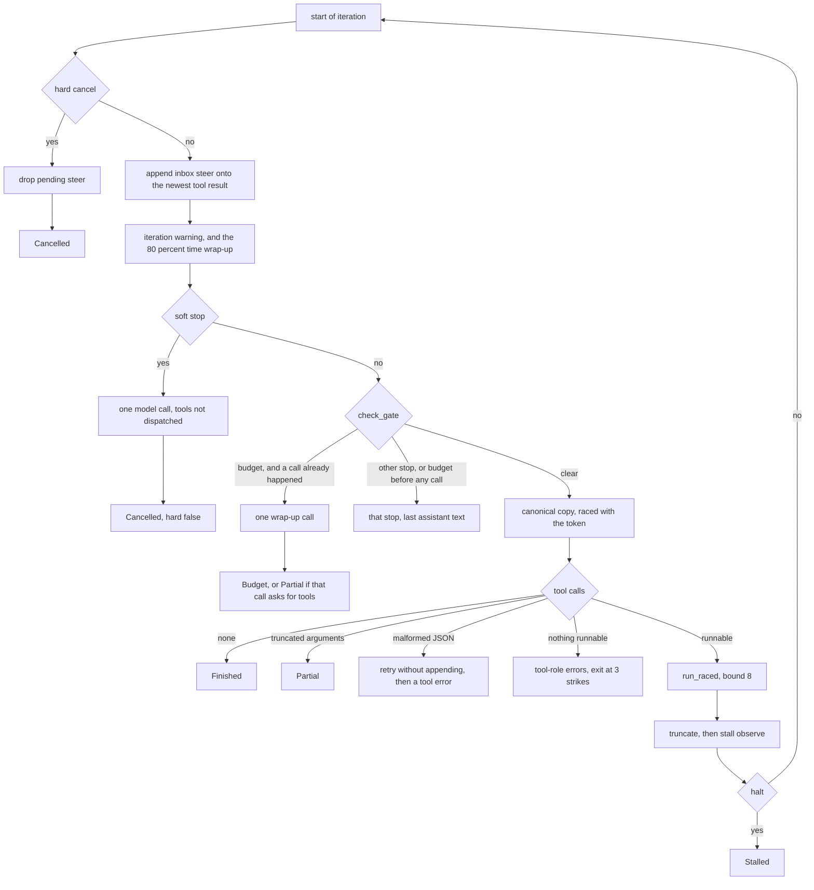

# Chapter 9: The Agent Loop

*Draft. Bracketed notes like [personal note] are where my own story goes.*

The earlier chapters can each do one piece of a turn. Chapter 1 can ask a model. Chapter 2 can hold the messages and a session inbox. Chapter 3 can run tools, reads together and a write alone. Chapter 4 can run those tools in another process. Chapter 6 can keep a huge catalog off the prompt. None of them yet asks the model, runs what it asked for, and asks again.

This chapter is that loop, in ten copies. Each copy adds one behavior and keeps the ones before it. The mock stays the default. `--live` is an opt-in that calls OpenRouter with two real tools, `echo` and `note`. CI does not pass that flag, and it does not set a key.

By the end of the chapter a turn can:

- call the model, dispatch the tool calls, append the results, and call the model again
- stop on a hard cancel in the middle of a model call or a tool call, or take one soft wrap-up
- repair a close unknown tool name, retry broken JSON, and exit with the partial transcript after three bad batches
- notice an identical call or a short A, B cycle, and halt
- warn at half the iteration budget, and append a wrap-up notice once the time budget is 80% spent
- cap a tool result, append a steer from the session inbox, and send tool-call arguments in a stable JSON form
- return one typed outcome per exit, and make a final wrap-up call when the budget runs out
- pass a saved eval set and four stress tasks on the mock

| Section | Step | What it adds |
|---|---|---|
| 9.1 | `steps/ch09-1-live` | the loop, plus an optional `--live` OpenRouter call |
| 9.2 | `steps/ch09-2-cancel` | a `CancellationToken`, raced with each model call and each tool call, and a soft stop |
| 9.3 | `steps/ch09-3-validate` | tool-call validation: repair, retries, and a 3-strike exit |
| 9.4 | `steps/ch09-4-stall` | identical-call and cycle detection |
| 9.5 | `steps/ch09-5-budget` | an iteration warning, a time-budget wrap-up, refunds, and a subagent cap |
| 9.6 | `steps/ch09-6-truncate` | a per-tool output cap |
| 9.7 | `steps/ch09-7-steer` | steering through the session inbox |
| 9.8 | `steps/ch09-8-canonical` | stable tool-call arguments on the send path |
| 9.9 | `steps/ch09-9-outcome` | a `TurnOutcome` enum, and a budget wrap-up call |
| 9.10 | `steps/ch09-10-evals` | stress evals, still optional to run live |

The section numbers in this chapter stay 9.1–9.10. They match the `steps/ch09-*` crate names. The book number is 9.

Each crate sets `rust-version = "1.88"` because it includes the chapter 4 client. `rmcp` 3.5.1 needs that compiler. The library package is `ch06-N-harness-core`. The binary is `ch06-N-harness`.

> **How Hermes does it**
>
> I read the current `main` of [Hermes Agent](https://github.com/NousResearch/hermes-agent) before rewriting this chapter, and I checked those paths again at `e5eb6b36` (2026-10-16) while writing chapters 5, 7, 8, and 10. `run_conversation` is still in `agent/conversation_loop.py`. `validate_tool_calls` still calls `agent._repair_tool_call`. `HEAD_RATIO` is still 0.4 in `tools/tool_output_truncate.py`. `_MAX_TOOL_WORKERS` is still 8 in `agent/tool_executor.py`. The measured numbers below are unchanged. The once-per-turn prologue is `build_turn_context` in `agent/turn_context.py`.
>
> **Adopted.** `validate_tool_calls` in `agent/turn_tool_validation.py` uniquifies duplicate tool-call ids, repairs a close name through `agent._repair_tool_call` before the name check, advances the invalid-name strike only when the batch has no valid call, and stops at 3. Malformed JSON is retried up to 3 times without appending, then closed with a tool-role error so the roles still alternate. Arguments that do not end in `}` or `]` are treated as truncated and refused, with no retry. `_invalid_tool_name_error_content` in `conversation_loop.py` lists the catalog for a nonempty unknown name and withholds it when the name is blank. `IterationBudget` in `agent/iteration_budget.py` is a consume/refund counter: the parent cap and each subagent cap are separate, and `execute_code` is the documented refund. `normalize_budget_warning_ratio` keeps a finite ratio strictly between 0 and 1. The warning sentence in `agent/turn_iteration_prep.py` (`ITERATION_BUDGET_WARNING_TEMPLATE`) and the time-budget sentence in `conversation_loop.py` (`RUN_BUDGET_WRAPUP_NOTICE`, appended by `_maybe_inject_run_budget_wrapup` once elapsed time passes `0.8 * run_budget_seconds`) both land on the newest `role: "tool"` message. `tools/tool_output_truncate.py` keeps 40% of the head and the rest of the tail (`HEAD_RATIO = 0.4`) and puts the omitted-count notice on top. `_canonicalize_tool_call_arguments` sorts keys and emits compact JSON (`separators=(",", ":")`, `sort_keys=True`) on a send-path copy (`_clone_message_for_send`), so the stored transcript is left alone. `agent/interrupt_control.py` distinguishes a hard stop, which drops a pending steer, from a soft clear, which must not. `agent/tool_guardrails.py` stubs a long byte-identical result from the second repeat (`STALL_GUARD` stub at length 512) and notices an identical streak at 3. Its cycle detector uses period 2 through 4 and a history of 64. Concurrent tool calls go through a pool capped at `_MAX_TOOL_WORKERS = 8` in `agent/tool_executor.py`. The developer guide (`website/docs/developer-guide/agent-loop.md`) says a batch runs on a `ThreadPoolExecutor` and the results are restored in the original order.
>
> **Adapted.** Hermes's parent `max_iterations` default is 500, and `budget_warning_ratio` defaults to off (`None`). This chapter's parent cap is 8, the same bound the rest of the book uses for in-flight work, and the warning defaults to 0.5 so the demo can show the sentence. Hermes inserts a steer as its own user row (`_inject_steer_after_newest_tool_result`). This chapter appends the steer text onto the newest tool result, the same site as the two budget notices, so the cached prefix stays put and the next role stays assistant. Hermes halts an identical streak at `no_progress_block_after` (default 5) when hard stops are enabled, and it halts a cycle at that same config. This chapter notices at streak 3 and halts at streak 4, and it halts a cycle at 3 laps. The stub wording drops the product name: `[note: this result is byte-identical to the {tool} result earlier this turn. ...]`. Hermes's blank-name error is a longer anti-priming paragraph. This chapter keeps the split (no catalog when the name is blank) and uses one line, `error: tool name is empty`. A single Hermes tool call stays on the calling thread. A single read here still takes a permit from the bound of 8. This chapter's `repair_name` is a unique prefix of length at least 2, or a unique Levenshtein distance of at most 2. A tie does not repair. Hermes performs that repair by calling `agent._repair_tool_call` at the validation site. The Rust rule is the one this chapter states. The canonicalizer has no memo cache. Hermes keeps one (`_CANON_ARGS_CACHE`, 4096 entries). The 1024-character tool cap is this chapter's. Hermes stores its limits in `tools/tool_output_limits.py`, and I did not copy a number from there. The subagent tool in this chapter is named `delegate`. Hermes intercepts `delegate_task`.
>
> **Deferred.** Empty-response retries after tool calls (`_EMPTY_TOOL_RESPONSE_NUDGE` in `conversation_loop.py`), length continuation (`agent/turn_truncation.py`, `recover_from_truncation`), and the repetition guard (`agent/repetition_guard.py`, `is_runaway_repetition`) wait for chapter 14, When Things Fail. Preflight compression inside `build_turn_context` (`agent/turn_context.py`, `agent/context_compressor.py`) waits for chapter 32, Managing Context. `apply_stop_gates` in `agent/turn_stop_gates.py` can keep a turn going after a candidate answer: verify-on-stop, the `pre_verify` hook, and the kanban terminal-tool guard. Those nudges wait until the chapters that have a verifier and a board. The poller exemption in `tool_guardrails.py` (`process_manage`, and names ending in `_get_result` or `_poll`) waits until this harness has a poller. The idea I did take from the stop gates is the smaller one: a stop can continue the turn or return, and a candidate answer is kept for the budget-exhaustion fallback.

[personal note: the first time a loop kept calling the model after you had meant to stop it]

## What this chapter decides

The loop does not know whether a tool is native or MCP. Both are `Arc<dyn Tool>`. The tests register `EchoTool` and, separately, the chapter 4 fixture's `echo` over stdio and over streamable HTTP. The same `run_loop` handles all three.

The provider in the tests is scripted. A `ScriptedReply` is text, or tool calls, and an optional `Usage`. The mock leaves usage empty unless a test sets it. That is the same rule as chapter 1: the mock does not invent a bill. `LiveProvider::calls` stays 0. The loop counts a call from the events.

The gate runs before `complete`. A reply that has already arrived is part of the transcript. The budget can refuse the next request. A final answer with no tool calls returns `Finished` even when that reply's token count is over the cap, because there is no next request. The tests that expect `Budget` use a tool call as the first reply, so the loop has a wrap-up call to make.

A hard cancel and a soft stop are different. Hard cancel aborts the in-flight model call or tool call and drops a pending steer. Soft stop lets the current work finish, then makes one model call and does not dispatch tools from that reply.

Every path that accepted a tool call answers it with a tool message. An unknown name, a timeout, a tool error, a malformed payload that has used up its retries, and a subagent call over its cap all come back as `Role::Tool`. The next model call then sees assistant, then tool, then assistant.

Streaming still waits until the buffered reply is in hand, then overlaps the safe calls. Parsing a tool call out of a token stream and starting it early is chapter 17.

## The loop



## Walking `run_loop`

The function a session calls is `run_loop`. It forwards to `run_loop_with_inbox` with no inbox. `turn_from_inbox` pops one user line, pushes it, and calls the same function with `Some(&self.inbox)`. The walk below is the finished function, in `steps/ch09-10-evals`.

The locals that survive across iterations are the event log, `AgentUsage`, a JSON-retry count, an invalid-name strike count, a `StallGuard`, the iteration number the stall guard sees, and a `NoticeLatch` so each budget sentence is appended once.

**Hard cancel.** The first check is `cancel.is_cancelled()`. That reads the token. If it is set, and an inbox was passed, `drop_pending_steer` drains the inbox and throws the lines away. The turn returns `Cancelled` with whatever assistant text is already in the transcript. A steer that arrived during the aborted work does not get appended.

**Steer, then notices.** If the inbox is present and the transcript already has a tool message, queued lines are joined and appended to the newest tool result, after a blank line. A queue that arrives before any tool result stays queued. `append_steers` returns without popping in that case, so the line is still there after the first tool result. Then `inject_budget_notices` may append the iteration warning, the time wrap-up, or both, onto that same newest tool result. A hard cancel skips the notices. A message that already contains the sentence is left alone.

**Soft stop.** `is_soft_stop` does not cancel the token. The loop calls `soft_wrap_up`: one `complete` on the canonical copy, raced with the token. A text reply is pushed and the turn returns `SoftStop`. A reply that asks for tools is not pushed and the tools are not run. Pushing it would leave an assistant tool call with no tool result.

**The gate.** `check_gate` returns `Cancelled` if the token is set, or `Budget` if iterations, tokens, cost, or elapsed time are past the cap. A budget hit after at least one model call goes to `budget_wrap_up`, another single `complete` that does not dispatch tools. A text reply returns `Budget` with that text. A tool-call reply returns `Partial` and keeps the previous assistant text. A budget hit when `usage.calls` is still 0, which is a time cap that was already spent, returns `Budget` and does not call the provider.

**The model call.** The send is `canonical_messages(messages)`, a clone. The stored messages stay as they were. The call is raced:

```rust
let token = cancel.token();
let send = canonical_messages(messages);
let batch = tokio::select! {
    biased;
    _ = token.cancelled() => {
        return finish(StopReason::Cancelled, events, usage, last_text(messages));
    }
    batch = provider.complete(&send) => batch,
};
```

`biased` polls the token first. A token that is already cancelled wins over a provider future that is also ready. `absorb` copies the events, records `Usage` when the batch had one, and otherwise counts the call with no bill. The assistant message is the `Done` event. A batch with no `Done` is an error event and a `Budget` return.

**A final answer.** Empty `tool_calls` means the turn is over. The assistant message is pushed and the outcome is `Finished`.

**Validation.** `classify` uniquifies ids, repairs a close name, and tags truncated JSON, malformed JSON, and unknown names. Truncation returns `Partial` after the assistant message and the error tool results are pushed. There is no retry. Malformed JSON increments `json_retries` and `continue`s without pushing, while the count is under 3. On the third, the error tool results are pushed and the loop continues, so the model can answer. The strike counter moves only when the batch has nothing runnable and it was not this malformed-exhausted path. Three such batches return `InvalidToolCalls`. A mixed batch runs the valid calls, error-results the bad ones, and resets the strikes.

**Dispatch.** `delegate` calls count toward `max_subagent_iterations` (50). One past the cap is not run. It becomes `error: subagent iteration cap`. Everything else goes to `dispatcher.run_raced`, which is the chapter 3 scheduler plus a `select!` against the same token and a 30 second timeout. A timeout or a `ToolError` becomes `error: timeout` or `error: {error}` on the tool message.

**After the tool.** The result text is truncated to 1024 characters, head and tail, before the stall guard sees it. `stall.observe` compares the tool name, the arguments, and that text with the previous call from an earlier iteration. Two calls in the same iteration are siblings. They do not extend the streak, so eight `delay_read`s in one batch do not look like a stall. A long identical result is replaced with the stub from the second repeat. The guard still remembers the original text, so the next iteration can match. A successful `execute_code` refunds one iteration. The tool message that is pushed is the stub or the truncated text, plus a notice when the streak or a cycle says so. If the guard says halt, the turn returns `Stalled` after the messages are on the transcript.

`finish` maps a `StopReason` onto the `TurnOutcome` variant. `last_text` is the latest assistant message whose `tool_calls` are empty.

> **Rust sidebar: `select!` and the token**
>
> - `CancellationToken` comes from `tokio_util`. Cloning it clones a handle. `cancel()` on any handle fires all of them.
> - `token.cancelled()` is a future. It is ready when the token is cancelled.
> - `select!` waits on two futures and keeps the one that finishes first. `biased;` polls the cancel arm before the model arm.
> - Bind `let token = cancel.token();` before the macro. Writing `cancel.token()` inside `select!` drops the temporary while the future still borrows it.
> - Soft stop is a different `Arc<AtomicBool>`. Setting it does not cancel the token, so an in-flight sleep is not aborted to deliver the stop.

## 9.1 A live call, and the mock that stays the default

`OpenAiCompatible` in this chapter is a second client, in `live.rs`. It posts to `https://openrouter.ai/api/v1` with model `openai/gpt-4o-mini`, and it sends the schemas for `echo` and `note`. `EchoTool` is the read. `NoteTool` is the write: it requires `text` and returns `noted:{text}`.

The CLI accepts `--mock` and `--live`. Neither flag means mock. Both flags is an error. `--live` with no key prints the chapter 1 string and exits 1. I ran that with `OPENROUTER_API_KEY` unset. I did not run `--live` against OpenRouter, so this chapter has no live transcript. The request body is checked with wiremock: `the_live_client_posts_echo_and_note_and_parses_a_tool_call` posts both tool names and parses a scripted tool call from the response.

The mock demo registers the chapter 4 fixture over stdio, submits `say hello`, and runs a script that calls `echo` and then answers `hello`.

### Build, run, and benchmark

```bash
cargo nextest run -p ch09-1-harness-core --locked
cargo run -p ch09-1-harness-core --example demo --locked --offline --quiet
cargo run -p ch09-1-harness-cli --locked --offline --quiet -- ask "say hello"
cargo run -p ch09-1-harness-cli --locked --offline --quiet -- --live ask "say hello"
cargo bench -p ch09-1-harness-core --bench loop_iter --locked --offline -- --warm-up-time 1 --measurement-time 2 --sample-size 10
```

```text
     Summary [   0.042s] 11 tests run: 11 passed, 0 skipped
```

```text
event: tool-call echo id=call-1 args={"text":"hello"}
event: done
event: text-delta hello
event: done
tool-result: echo hello
stop: Finished
```

The `ask` command prints the same events and the tool result, without the `stop:` line. `--live` with the key unset:

```text
event: error missing OPENROUTER_API_KEY: pass --api-key, or run with --mock
error: missing OPENROUTER_API_KEY: pass --api-key, or run with --mock
```

The `time:` lines are Criterion's slope. The means are `mean.point_estimate` from that run's `estimates.json`. Machine: 4 vCPU, sample size 10, warm-up 1 s, measurement 2 s.

```text
gate_check              time:   [2.7475 ns 2.8672 ns 2.9507 ns]
loop_iteration          time:   [247.11 ns 247.65 ns 248.81 ns]
loop_8_reads            time:   [2.3216 ms 2.3507 ms 2.3815 ms]
live_tool_body          time:   [1.4322 µs 1.4379 µs 1.4437 µs]
```

| Benchmark | Mean | What it is |
|---|---|---|
| `gate_check` | 2.785 ns | `check_gate` on the section 9.1 budget |
| `loop_iteration` | 248.5 ns | one scripted final answer, no tool call |
| `loop_8_reads` | 2.370 ms | eight 1 ms reads, then the second reply |
| `live_tool_body` | 1.435 µs | building the echo and note request body |

2.370 ms is one wave of 1 ms sleeps plus the second scripted reply. It is not eight milliseconds. Later sections add checks, so the same two names on `ch09-10-harness-core` are slower. Those numbers are in 9.10. The Benchmarks job records each section before the next one starts, and the [benchmark dashboard](https://agnathan.github.io/rust-agent-harness/) keeps `9.1/loop_iteration` apart from `9.10/loop_iteration`. Older artifacts stored one row per function name. Those seeded points sit on section 9.10, because that section ran last. Runs from before the renumbering stored them as `6.10/…`, and section 9.1 as `6.1/…`. The dashboard still plots those points on these two sections.

## 9.2 Prompt cancellation

`CancelFlag` holds a `CancellationToken` and an `Arc<AtomicBool>`. `cancel` and `hard_stop` cancel the token. `soft_stop` sets the bool and leaves the token alone. `clear_soft` does not touch the inbox.

Each model call uses the `select!` above. Each tool call uses another one inside `run_raced`. A fired token becomes `ToolError::Failed { message: "cancelled" }`, which the loop turns into a tool message `error: cancelled`. The rest of the batch still gets a result, so the transcript does not stop halfway through a parallel read.

The tests:

- `a_hard_stop_aborts_an_in_flight_model_call` cancels during `complete`. The provider's call count stays 1.
- `a_hard_stop_aborts_an_in_flight_tool_call` cancels a sleep. The next model request does not start.
- `a_soft_stop_finishes_the_tool_then_one_wrap_up` lets the tool return, then takes the wrap-up text.
- `a_soft_wrap_up_that_asks_for_tools_does_not_run_them`.
- `hard_stop_drops_a_pending_steer_and_soft_stop_does_not`.

### Build, run, and benchmark

```bash
cargo nextest run -p ch09-2-harness-core --locked
cargo run -p ch09-2-harness-core --example demo --locked --offline --quiet
cargo bench -p ch09-2-harness-core --bench loop_iter --locked --offline -- --warm-up-time 1 --measurement-time 2 --sample-size 10 cancel_select
```

```text
     Summary [   0.066s] 16 tests run: 16 passed, 0 skipped
```

The demo's tool sets the soft flag from inside `call`. The next iteration is the wrap-up.

```text
event: tool-call soft_on_call id=call-1 args={}
event: done
event: text-delta wrapping up
event: done
stop: SoftStop
final: wrapping up
```

```text
cancel_select           time:   [155.71 ns 156.97 ns 159.55 ns]
```

| Benchmark | Mean | What it is |
|---|---|---|
| `cancel_select` | 156.9 ns | one already-cancelled `select!` against a ready tool future |

## 9.3 Tool-call validation

`classify` in `validate.rs` is the Hermes shape: repair, then decide, and always close with a tool result when the call is not going to be retried.

`repair_name` returns a new name only when one known tool is the unique match. A prefix has to be at least two characters. A Levenshtein distance has to be at most 2, and it has to be strictly closer than every other name. `eco` repairs to `echo`. Two names at the same distance stay broken, and the model gets the catalog.

```rust
pub fn unknown_message(name: &str, known: &[String]) -> String {
    if name.trim().is_empty() {
        "error: tool name is empty".to_string()
    } else {
        let mut names = known.to_vec();
        names.sort();
        format!(
            "error: Tool '{name}' does not exist. Available tools: {}",
            names.join(", ")
        )
    }
}
```

A repaired name is what gets stored on the assistant message. The model sees the tool it can actually call on the next turn.

The tests, all on the mock:

- `an_unknown_name_repairs_to_the_close_tool`
- `three_unknown_batches_return_the_partial_transcript` expects `InvalidToolCalls`, with tool-role errors so the roles stay assistant, tool, assistant
- `a_mixed_batch_runs_the_valid_call_and_resets_strikes`
- `malformed_json_is_retried_then_returned_as_a_tool_error` uses `{"text":}`, which ends in `}` and still does not parse
- `truncated_arguments_stop_without_a_retry`
- `a_tool_timeout_comes_back_as_a_tool_result` sets the timeout to 40 ms and expects `error: timeout`
- `duplicate_tool_call_ids_are_made_unique`

`MAX_INVALID_STRIKES` and `MAX_JSON_RETRIES` are both 3.

### Build, run, and benchmark

```bash
cargo nextest run -p ch09-3-harness-core --locked
cargo run -p ch09-3-harness-core --example demo --locked --offline --quiet
cargo bench -p ch09-3-harness-core --bench loop_iter --locked --offline -- --warm-up-time 1 --measurement-time 2 --sample-size 10 validate_repair
```

```text
     Summary [   0.082s] 27 tests run: 27 passed, 0 skipped
```

The demo's script asks for `eco`. The stored call is `echo`, and the tool runs.

```text
repaired: echo
tool-result: echo hello
stop: Finished
```

```text
validate_repair         time:   [188.27 ns 189.02 ns 190.09 ns]
```

| Benchmark | Mean | What it is |
|---|---|---|
| `validate_repair` | 188.8 ns | repairing `eco` against a one-tool catalog |

## 9.4 Stall detection

`StallGuard::observe` records the last call that came from an earlier iteration. A match on tool, arguments, and result increments the streak. Anything else resets it to 1. Siblings in the same iteration do not count.

From the second identical repeat, a result of at least 512 characters that did not fail is replaced with the stub. The notice is appended when the streak reaches 3. The turn halts when the streak reaches 4 (`StopReason::Stalled`).

Cycles are separate. The history keeps 64 calls. A period of 2, 3, or 4 that repeats for at least 3 laps, and that spans at least two iterations, sets halt. `A, B, A, B, A, B` is three laps of period 2. The test is `an_alternating_cycle_halts_after_three_laps`. The identical-call test is `a_long_duplicate_is_stubbed_on_the_second_repeat_and_halts`.

The stub the demo prints is the first line of the second tool result. The arguments preview is 80 characters, so the line ends in the middle of the payload.

### Build, run, and benchmark

```bash
cargo nextest run -p ch09-4-harness-core --locked
cargo run -p ch09-4-harness-core --example demo --locked --offline --quiet
cargo bench -p ch09-4-harness-core --bench loop_iter --locked --offline -- --warm-up-time 1 --measurement-time 2 --sample-size 10 stall_observe
```

```text
     Summary [   0.094s] 29 tests run: 29 passed, 0 skipped
```

```text
stub: [note: this result is byte-identical to the echo result earlier this turn. Refer to that result; it has not changed. Args: {"text":"xxxxxxxxxxxxxxxxxxxxxxxxxxxxxxxxxxxxxxxxxxxxxxxxxxxxxxxxxxxxxxxxxxxxxxx]
stop: Stalled
```

```text
stall_observe           time:   [99.881 ns 100.18 ns 100.51 ns]
```

| Benchmark | Mean | What it is |
|---|---|---|
| `stall_observe` | 100.0 ns | one `observe` of a repeated echo |

## 9.5 Budget warnings and wrap-up

`Budget::default` is 8 iterations, no token cap, no cost cap, no time cap, `warning_ratio: Some(0.5)`, and `max_subagent_iterations: 50`. `normalize_warning_ratio` returns `None` unless the value is finite and strictly between 0 and 1. That part matches Hermes. The default of 0.5 is this chapter's, so a four-iteration demo actually prints the sentence.

The warning is appended when `usage.calls >= min(floor(ratio * max), max - 1)`, and only onto a tool message. The demo uses `max_iterations: 4` and two echo calls. After the second call the newest tool result is:

```text
two

[SYSTEM NOTICE — iteration budget checkpoint] You have used 2 of 4 iterations. Checkpoint durable progress now, then continue the task; do not stop solely because of this warning.
```

The time notice uses the Hermes sentence, stored as `RUN_WRAPUP_NOTICE`. It is appended once `elapsed >= 0.8 * max_duration`, latched, and skipped when the tool message already contains it. Both notices are cache-safe in the same way Hermes describes: they edit the newest tool result, which has not been sent yet, and they leave the system prompt and the earlier turns alone.

`AgentUsage::refund_iteration` decrements `calls` when it is above 0. A successful `execute_code` takes that refund, so a cap of 1 still allows the following model call. `delegate` over the subagent cap returns `error: subagent iteration cap` and the tool body does not run. The parent's `max_iterations` is unchanged.

The tests are `the_warning_ratio_is_on_here_and_off_outside_the_open_interval`, `a_warning_is_appended_to_the_newest_tool_result`, `past_eighty_percent_of_the_time_budget_appends_the_wrap_up`, `execute_code_refunds_one_iteration`, and `a_delegate_past_the_subagent_cap_is_an_error_result`.

### Build, run, and benchmark

```bash
cargo nextest run -p ch09-5-harness-core --locked
cargo run -p ch09-5-harness-core --example demo --locked --offline --quiet
cargo bench -p ch09-5-harness-core --bench loop_iter --locked --offline -- --warm-up-time 1 --measurement-time 2 --sample-size 10 budget_notice
```

```text
     Summary [   0.096s] 34 tests run: 34 passed, 0 skipped
```

```text
two

[SYSTEM NOTICE — iteration budget checkpoint] You have used 2 of 4 iterations. Checkpoint durable progress now, then continue the task; do not stop solely because of this warning.
stop: Finished
```

```text
budget_notice           time:   [57.775 ns 58.039 ns 58.366 ns]
```

| Benchmark | Mean | What it is |
|---|---|---|
| `budget_notice` | 58.20 ns | appending the iteration warning onto a tool message |

## 9.6 A per-tool output cap

`truncate_head_tail` leaves a string alone when it fits. When it does not, the kept slice is exactly `max_chars` long and the notice rides on top. The head is `floor(max * 0.4)`. The tail is the rest. The chapter cap, `TOOL_OUTPUT_MAX_CHARS`, is 1024.

The notice matches the Hermes wording, including the thousands separators:

```text
... [OUTPUT TRUNCATED - 976 chars omitted out of 2,000 total] ...
```

That line is a 2,000-character echo. The head is 409 characters, the tail is 615, and 976 were omitted. Truncation runs before `stall.observe`, so a stub replaces the truncated text and not a 2,000-character payload the model will never see.

### Build, run, and benchmark

```bash
cargo nextest run -p ch09-6-harness-core --locked
cargo run -p ch09-6-harness-core --example demo --locked --offline --quiet
cargo bench -p ch09-6-harness-core --bench loop_iter --locked --offline -- --warm-up-time 1 --measurement-time 2 --sample-size 10 truncate_output
```

```text
     Summary [   0.102s] 36 tests run: 36 passed, 0 skipped
```

```text
... [OUTPUT TRUNCATED - 976 chars omitted out of 2,000 total] ...
stop: Finished
```

```text
truncate_output         time:   [3.1601 µs 3.2221 µs 3.2563 µs]
```

| Benchmark | Mean | What it is |
|---|---|---|
| `truncate_output` | 3.174 µs | head-and-tail of a long tool result |

## 9.7 Steering

`SessionInbox` is `Clone` from this section on. The queue sits behind `Arc<Mutex<_>>`, bound 64, the same bound as chapter 2.

> **Rust sidebar: one inbox, two owners**
>
> - `Clone` on `SessionInbox` copies the `Arc`. The tool and the loop share the queue.
> - The mutex is held for the `submit` or the `pop`. It is not held across `complete`.
> - `run_loop` still has the seven-argument signature and passes `None`. `turn_from_inbox` passes `Some(&self.inbox)`.

Between iterations, if a tool message exists, the loop pops every queued line and appends them to the newest tool result. The demo's tool submits `use the short form` during `call`. The next model call sees it on that result.

A hard cancel drains the inbox in `drop_pending_steer` and does not append. The test is `a_hard_stop_drops_the_pending_steer_instead_of_appending_it`.

### Build, run, and benchmark

```bash
cargo nextest run -p ch09-7-harness-core --locked
cargo run -p ch09-7-harness-core --example demo --locked --offline --quiet
cargo bench -p ch09-7-harness-core --bench loop_iter --locked --offline -- --warm-up-time 1 --measurement-time 2 --sample-size 10 steer_append
```

```text
     Summary [   0.095s] 38 tests run: 38 passed, 0 skipped
```

```text
looked

use the short form
stop: Finished
```

```text
steer_append            time:   [46.992 ns 48.089 ns 49.123 ns]
```

| Benchmark | Mean | What it is |
|---|---|---|
| `steer_append` | 47.12 ns | appending one steer line onto a tool message |

## 9.8 Stable request formatting

`canonical_json` parses, sorts object keys recursively, and serializes with `serde_json::to_string`. That is compact JSON: no spaces. `canonical_messages` clones the transcript and rewrites tool-call arguments on the clone. The provider sees the clone. The stored `raw_arguments` stay in the order the model sent.

`prompt_prefix` is the byte string the test compares: role, content, tool-call id, and `id:name:args` for each call. Two calls on `{"b":1,"a":2}` produce one string, `{"a":2,"b":1}`, and the two prefixes compare equal. The test is `unsorted_keys_become_sorted_and_the_prefix_is_byte_identical`. `the_provider_sees_the_canonical_copy` turns recording on and checks the messages `complete` received.

The demo is synchronous. It does not start a runtime.

### Build, run, and benchmark

```bash
cargo nextest run -p ch09-8-harness-core --locked
cargo run -p ch09-8-harness-core --example demo --locked --offline --quiet
cargo bench -p ch09-8-harness-core --bench loop_iter --locked --offline -- --warm-up-time 1 --measurement-time 2 --sample-size 10 canonical_args
```

```text
     Summary [   0.105s] 40 tests run: 40 passed, 0 skipped
```

```text
raw: {"b":1,"a":2}
canonical: {"a":2,"b":1}
byte-identical: true
```

```text
canonical_args          time:   [765.86 ns 768.12 ns 772.04 ns]
```

| Benchmark | Mean | What it is |
|---|---|---|
| `canonical_args` | 771.0 ns | sorting one small arguments object |

## 9.9 A typed turn outcome

Through section 9.8, `TurnOutcome` was a struct with a `stop` field. A caller could pair `Finished` with an empty transcript. Section 9.9 makes the exit the type.

```rust
pub enum TurnOutcome {
    Finished { events: Vec<Event>, usage: AgentUsage, text: String },
    Partial { events: Vec<Event>, usage: AgentUsage, text: String },
    Budget { events: Vec<Event>, usage: AgentUsage, text: String },
    Cancelled { events: Vec<Event>, usage: AgentUsage, text: String, hard: bool },
    Stalled { events: Vec<Event>, usage: AgentUsage, text: String },
    InvalidToolCalls { events: Vec<Event>, usage: AgentUsage, text: String },
}
```

`events()`, `usage()`, and `text()` borrow the fields. `label()` is the variant name. `stop()` maps `Cancelled { hard: false }` back to `StopReason::SoftStop` and `Cancelled { hard: true }` to `StopReason::Cancelled`.

> **Rust sidebar: the exit is the variant**
>
> - Each arm carries the transcript, the usage, and the text the caller should show.
> - `finish` is the only constructor. It matches on `StopReason` and builds one variant.
> - A wrap-up that returns text is `Budget` with that text. A wrap-up that returns tool calls is `Partial`, and those calls are not pushed.

The demo sets `max_tokens: Some(50)` and a first reply whose `Usage.total_tokens` is 100, with `cost: Some(0.25)`. The gate fires before the next ordinary call. Because `usage.calls > 0`, that next call is the wrap-up, and the script's second reply is `budget answer`. The provider's `calls()` is 2. A time cap that is already spent, with `calls` still 0, does not take this path. `provider.calls()` stays 0.

`a_wrap_up_that_asks_for_tools_returns_partial` covers the other arm.

### Build, run, and benchmark

```bash
cargo nextest run -p ch09-9-harness-core --locked
cargo run -p ch09-9-harness-core --example demo --locked --offline --quiet
cargo bench -p ch09-9-harness-core --bench loop_iter --locked --offline -- --warm-up-time 1 --measurement-time 2 --sample-size 10 outcome_label
```

```text
     Summary [   0.099s] 41 tests run: 41 passed, 0 skipped
```

```text
stop: Budget
text: budget answer
```

```text
outcome_label           time:   [5.5660 ns 5.6528 ns 5.7058 ns]
```

| Benchmark | Mean | What it is |
|---|---|---|
| `outcome_label` | 5.606 ns | `label()` on a finished outcome |

## 9.10 Stronger evals

`run_saved_evals` is the three tasks from the first version of this chapter. `echo-hello` calls `echo` and finishes with `hello`. `direct` finishes with `ok` and calls nothing. `eight-reads` fans eight `delay_read`s of 20 ms and fails the score if the peak in flight is above 8. Later chapters re-run this set. Chapter 48 is where it gets a score report.

`run_stress_evals` adds four:

| Eval | What the script does | Expected stop |
|---|---|---|
| `tool-fails-then-recovers` | `flaky` fails once with `boom`, then returns `ok`, then the model says `recovered` | `Finished` |
| `hits-iteration-cap` | two echo calls under `max_iterations: 2`, then the wrap-up text `partial` | `Budget` |
| `unknown-tool-repair` | the model asks for `eco` | `Finished`, and the stored name is `echo` |
| `stall` | `STALL_HALT_AFTER` echoes of a 512-character payload | `Stalled`, and a stub that says the result is byte-identical |

`prepare_live_evals(None)` returns the missing-key string and does not construct a client. The CLI flag is `--live-evals`. With a key it would call `live_evals`, which uses the same OpenRouter client as `--live`. I ran the flag with the key unset. I did not run it with a key. CI does not pass the flag.

### Build, run, and benchmark

```bash
cargo nextest run -p ch09-10-harness-core --locked
cargo run -p ch09-10-harness-core --example demo --locked --offline --quiet
cargo run -p ch09-10-harness-cli --locked --offline --quiet -- evals
cargo run -p ch09-10-harness-cli --locked --offline --quiet -- --live-evals evals
cargo bench -p ch09-10-harness-core --bench loop_iter --locked --offline -- --warm-up-time 1 --measurement-time 2 --sample-size 10
```

```text
     Summary [   0.099s] 43 tests run: 43 passed, 0 skipped
```

The example and `evals` print the same seven lines.

```text
eval: echo-hello pass
eval: direct pass
eval: eight-reads pass
eval: tool-fails-then-recovers pass
eval: hits-iteration-cap pass
eval: unknown-tool-repair pass
eval: stall pass
```

`--live-evals` with the key unset prints the same missing-key error as `--live`. No socket is opened.

On `ch09-10-harness-core`, after a 1 s warm-up, 2 s of measurement, and 10 samples:

```text
gate_check              time:   [11.916 ns 11.935 ns 11.959 ns]
loop_iteration          time:   [606.16 ns 609.57 ns 611.45 ns]
loop_8_reads            time:   [2.3919 ms 2.4241 ms 2.4470 ms]
stress_repair           time:   [20.602 µs 20.717 µs 20.871 µs]
```

| Benchmark | Mean | Target | What it is |
|---|---|---|---|
| `gate_check` | 11.92 ns | < 1 µs | the finished `check_gate` |
| `loop_iteration` | 608.0 ns | < 1 ms, excluding the model | one scripted final answer through every check |
| `loop_8_reads` | 2.421 ms | one wave of 1 ms reads | eight reads plus validation, truncation, and the stall guard |
| `stress_repair` | 20.80 µs | the repair path inside an eval | the unknown-tool-repair task |

608.0 ns against the section 9.1 figure of 248.5 ns is the cost of the checks that run even when the reply is just text: the steer scan, the notice latch, the gate, the canonical clone, and the `select!`. Both are under 1 ms. 2.421 ms against 2.370 ms is the same eight sleeps, plus the work that now sits around them.

## Pitfalls

A final text reply returns `Finished` even when the token count is over the cap. The gate sits in front of the next call, and there is no next call. A budget test has to use a tool call first so the wrap-up exists.

A time cap that is already spent, with `usage.calls == 0`, returns `Budget` and does not call the provider. The wrap-up is only for a turn that has already spent a call.

Eight identical reads in one batch do not stall. They share an iteration, and the cycle detector requires the window to span two iterations. A stall is the same call on the next model round.

A steer submitted before any tool result stays in the inbox. `append_steers` does not pop until a tool message exists. Draining it early would drop the line.

Canonical JSON is the send-path copy. The stored `raw_arguments` stay unsorted. A test that looks at the transcript and expects sorted keys is looking at the wrong string.

The [benchmark dashboard](https://agnathan.github.io/rust-agent-harness/) charts section 9.1 and section 9.10 separately. Seeded history for the shared names is the section 9.10 mean, 608.0 ns for `loop_iteration`, because those artifacts stored one row per function name under `6.10/loop_iteration`. Quoting the section 9.1 mean of 248.5 ns as the finished loop would hide the checks.

## Guardrails in this chapter

Layer L4. The catalog is [`docs/hermes-guardrails.md`](../docs/hermes-guardrails.md).

**Tool-call validation (K1, `agent/turn_tool_validation.py`).** `classify` calls `uniquify_ids` so a repeated id in one batch becomes `id-{index}`, which is the id half of Hermes K4. `repair_name` accepts a unique prefix of length at least 2, or a unique Levenshtein distance of at most 2. The comment on that function says it is adapted from Hermes `_repair_tool_call` and leaves the rest of the Python table out. An unknown name becomes `unknown_message`, which sorts the known names. A blank name is `error: tool name is empty` and does not list the catalog. Arguments that do not end in `}` or `]` are truncated: the turn returns `StopReason::Partial` on that batch. Malformed JSON increments `json_retries` and the loop continues while the count is under `MAX_JSON_RETRIES` (3); the batch that reaches 3 is pushed as a tool error. Three batches with nothing runnable (`MAX_INVALID_STRIKES`, 3) return `InvalidToolCalls`.

**Stall (J2, and only part of J1).** `StallGuard::observe` raises the streak when the tool, the arguments, and the result match the previous call from an earlier iteration. A sibling in the same iteration does not move the streak. A successful result of at least `STUB_MIN_CHARS` (512) is replaced with `stub_text` once the streak is at least 2. At `STALL_NOTICE_AT` (3) the text gains a repeat note. At `STALL_HALT_AFTER` (4), or when a cycle of period 2 through `MAX_CYCLE_PERIOD` (4) has completed `CYCLE_HALT_LAPS` (3), the loop returns `StopReason::Stalled`. The history window is 64. Hermes J2 is the `STALL_GUARD_*` constants in `agent/tool_guardrails.py`. J1, `ToolCallGuardrailController` in that same file, warns and then hard-stops, with hard stop off by default and on for non-interactive runs. That controller is not this guard, and no later chapter is assigned it.

**Budgets (I1 and I2, with different defaults).** `Budget::default` is 8 iterations, no token cap, no cost cap, no duration cap, a warning ratio of 0.5, and `max_subagent_iterations` of 50. Hermes leaves `agent.budget_warning_ratio` null and `agent.max_turns` unlimited. The iteration-budget doc default is 500, and children use `delegation.max_iterations` 250 (`agent/iteration_budget.py`, `hermes_cli/config_defaults.py`). `exceeded` is true when `calls >= max_iterations`, when tokens pass a cap that was set, when `cost_known` is true and `cost_usd` passes a cap that was set, or when elapsed time passes a duration that was set. A missing cost cannot trip the cost cap. The iteration warning is appended once, to the newest tool message, at half of `max_iterations`. If `max_duration` is set, the wrap-up notice is appended at 80 percent of it. The default leaves duration unset, so that notice does not fire. A successful `execute_code` calls `usage.refund_iteration()`. A call named `delegate` increments `subagent_calls`, and at the cap the tool result is `error: subagent iteration cap`. That is the subagent half of Hermes I3 (`LoopCapConfig` in `agent/tool_guardrails.py`, `max_subagents: 50`). The web-search half, also 50, is not implemented. Chapter 15 records it.

**Cancellation.** `CancelFlag::hard_stop` cancels the `CancellationToken`. `soft_stop` sets an `AtomicBool` and leaves the token alone, so an in-flight tool is not killed. The loop checks `is_cancelled` before the model call and races the token with `complete`. `check_gate` returns `Cancelled` or `Budget`, and that model call does not start. Soft stop takes one wrap-up and does not dispatch tools.

Empty-response retries (J4, `agent/empty_response_guard.py`) and the repetition guard (J3, `agent/repetition_guard.py`) are chapter 14. Stop-gate nudges (K6, `agent/turn_stop_gates.py`) stay deferred. Secret redaction (E1 and E2, `agent/redact.py`) is not in this loop.

## Chapter summary

- **Loop.** A scripted model call, the chapter 3 dispatcher, tool messages, and another call. Native `EchoTool` and the fixture's `echo`, over stdio and over streamable HTTP, share that path. One finished iteration with no tool call measured **608.0 ns**. The same bench on the section 9.1 crate, before the later checks, measured **248.5 ns**.
- **Live.** `--live` and `--live-evals` call OpenRouter with `echo` and `note` when a key is present. The mock is the default. The missing-key line is `missing OPENROUTER_API_KEY: pass --api-key, or run with --mock`. The request body was checked with wiremock. There is no live transcript in this chapter.
- **Cancel.** A `CancellationToken` is raced with each model call and each tool call. Soft stop is a separate flag. It finishes the current work, takes one wrap-up, and does not dispatch tools. Hard stop drops a pending steer.
- **Validation.** A unique close name is repaired. Three batches with nothing runnable return `InvalidToolCalls` and the partial transcript. Malformed JSON is retried, then answered with a tool error. Truncated arguments return `Partial` immediately. Timeouts and tool errors come back as tool results.
- **Stall.** A long identical result becomes a stub on the second repeat. The turn halts at streak 4, or after three laps of a short cycle.
- **Budget.** The warning at half the iterations, and the wrap-up past 80% of the time budget, are appended to the newest tool result. `execute_code` can refund one iteration. `delegate` has its own cap of 50.
- **The rest of the turn.** Tool output is capped at 1024 characters. A steer is appended to the newest tool result. Tool-call arguments are canonicalized on the copy that is sent. `TurnOutcome` has one variant per exit, and a spent budget takes one wrap-up call or returns `Partial`.
- **Evals.** Three saved tasks and four stress tasks pass on the mock.

## What's next

**Chapter 10: The Turn State Machine** is the transition table around `TurnOutcome`. `steps/ch10-turn-state` accepts or refuses each `(Phase, TurnEvent)` pair. It does not call `run_loop`. This chapter still stops at the value the loop returns.
