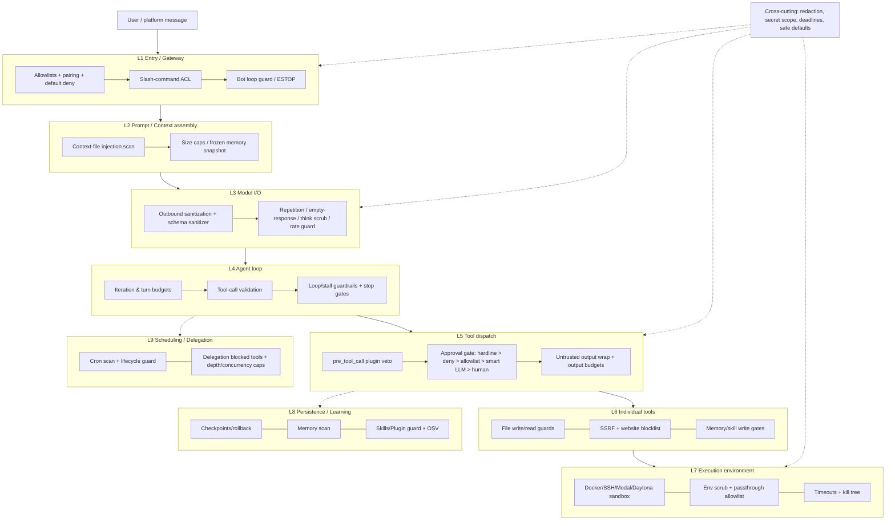

# Hermes Agent guardrails catalog

Source: `NousResearch/hermes-agent`, local clone `/workspace/hermes-agent`, commit `ca069e1223` (pulled 2026-10-14).
Method: `rg` and an AST scan of module/function docstrings and constants, plus direct reads of key functions and of
`hermes_cli/config_defaults.py` (the DEFAULT_CONFIG). Everything below was seen in code. Where a default could not be
confirmed, the entry says **default not verified**. "Code" in the Default column means it's hard-wired, with no config switch found.

Hermes says it plainly in `agent/file_safety.py`: *"Every guard here is defense-in-depth, NOT a security boundary: the
terminal tool runs as the same OS user."* The real boundaries are **human approval** and the **sandbox backend**.

---

## 1. Layer model

| # | Layer | What lives there |
|---|-------|------------------|
| L1 | **Entry / gateway** | Who may talk to the bot, which slash commands they may run, bot-to-bot loops, restart loops, ESTOP |
| L2 | **Prompt / context assembly** | Injection scan of AGENTS.md/SOUL.md/.cursorrules, size caps, frozen memory snapshot, steer markers |
| L3 | **Model I/O** | Outbound payload sanitization, schema sanitizing, think scrubbing, repetition guard, empty-response budget, rate-limit breaker, TLS |
| L4 | **Agent loop** | Iteration and turn budgets, wall-clock budget, tool-call validation, loop and stall guardrails, stop gates, transcript invariants |
| L5 | **Tool dispatch** | Plugin `pre_tool_call` veto, approval gate (hardline → deny globs → allowlist → smart LLM → human), untrusted-output wrapping, output budgets |
| L6 | **Individual tools** | File write denylist and read blocks, protected instruction files, URL/SSRF, website blocklist, browser eval policy, memory/skill write gates, self-repo guard |
| L7 | **Execution environment** | Docker hardening (cap-drop ALL, no-new-privileges, pids limit, network), env scrubbing, credential-file passthrough, timeouts and kill trees, symlink-safe spill files |
| L8 | **Persistence / learning** | Checkpoints and rollback, memory threat scan, skill write approval, Skills Guard, plugin guard, OSV malware check |
| L9 | **Scheduling / delegation** | Cron prompt scan, cron lifecycle guard, cron approvals deny, quota hold, delegation blocked tools, depth and concurrency caps, worktree isolation |
| X | **Cross-cutting** | Secret redaction (logs, tool output, egress), profile secret scoping, deadlines and timeouts, safe config defaults |

---

## 2. Categories (with counts)

| Category | Count | IDs |
|---|---|---|
| A. Human approval & consent | 10 | A1–A10 |
| B. Dangerous-command / action detection | 7 | B1–B7 |
| C. File-system & path protection | 8 | C1–C8 |
| D. Sandboxing & execution isolation | 6 | D1–D6 |
| E. Secrets & credential protection | 6 | E1–E6 |
| F. Prompt-injection & content trust | 7 | F1–F7 |
| G. Network / URL restrictions | 4 | G1–G4 |
| H. Supply chain (skills, plugins, MCP packages) | 5 | H1–H5 |
| I. Budgets, limits & timeouts | 7 | I1–I7 |
| J. Loop / stall / repetition guards | 6 | J1–J6 |
| K. Tool-call & message-flow integrity | 6 | K1–K6 |
| L. Gateway access control | 6 | L1–L6 |
| M. Scheduling & delegation limits | 7 | M1–M7 |
| N. Recovery: checkpoints, rollback, emergency stop | 3 | N1–N3 |
| **Total** | **88** | |

---

## 3. Catalog

Columns: **Protects against** · **How it works** · **Where** · **Default / config** · **Layer**

### A. Human approval & consent

| ID | Name | Protects against | How it works | Where | Default / config | Layer |
|---|---|---|---|---|---|---|
| A1 | Unified command guard | Destructive shell commands running unseen | Single entry that runs every pre-exec check (hardline, deny globs, allowlist, dangerous patterns, smart, human) and returns one decision. | `tools/approval.py` `check_all_command_guards`, `check_dangerous_command` | On; `approvals.mode: "smart"` | L5 |
| A2 | execute_code gate | Scripts that spawn subprocesses or mutate files bypassing the shell gate | Approves the whole script before the child process is spawned (redacted in the CLI). | `tools/approval.py` `check_execute_code_guard`, `_EXECUTE_CODE_GATE` | On | L5 |
| A3 | Smart approval (aux LLM) | Prompt fatigue; risky commands slipping past regex | An auxiliary LLM reviews the command with shell comments stripped (the command text is treated as untrusted, possibly injected) and returns APPROVE or DENY. Otherwise it escalates to the human. | `tools/approval_smart.py` | `approvals.mode: smart` (default), `approvals.smart_policy` | L5 |
| A4 | Unattended-mode fail-closed | Commands auto-running when nobody can answer | Cron, single-query (`-q`), and unattended platforms deny dangerous commands instead of waiting. | `tools/approval.py` `_CRON_CTX`, `_SINGLE_QUERY_CTX`; config | `approvals.cron_mode/single_query_mode/unattended_mode: "deny"` | L5/L9 |
| A5 | Approval timeout + transport fail-closed | Hung prompts; plugin approval transports approving silently | The wait times out and denies. A plugin transport timeout or error DENIES unless the fallback is `builtin`. | `tools/approval_human_wait.py`, `approval_gateway_wait.py`; config | `approvals.timeout: 300`; `security.approval: {transport: builtin, transport_fallback: deny}` | L5 |
| A6 | Denial breaker + "do not retry" contract | The model rephrasing a denied command over and over | The denial result tells the model the user has NOT consented and must not retry or rephrase. Per-session denial tallies trip a breaker. | `tools/approval.py` `_STOP_COMMAND`, `_STOP_ACTION`, `_DENIAL_TALLY_MAX_SESSIONS` | `approvals.denial_breaker_threshold: 3` | L5 |
| A7 | Session / permanent allowlist & YOLO scoping | Over-broad bypass | "Allow once / session / always". `always` is persisted to `command_allowlist`. `/yolo` is per-session, in memory, and carried explicitly across branch/compression. | `tools/approval.py` `approve_session`, `approve_permanent`, `is_approval_bypass_active_for_session`; `tools/approval_yolo.py` | `command_allowlist: []`; YOLO off | L5 |
| A8 | Plugin escalation to approval | Plugin-detected risk with no UI path | A `pre_tool_call` hook can escalate any tool call to the human gate. | `tools/approval.py` `request_tool_approval` | Opt-in (plugins) | L5 |
| A9 | Memory/skill write approval | Persistent poisoning of memory or skills | Cross-session writes are staged as pending (diff and gist shown) for `/memory approve` / `/skills`. Background-review writes are always staged when the gate is on. | `tools/write_approval.py` `evaluate_gate`, `stage_write` | Off unless `memory.write_approval` / `skills.write_approval` is truthy | L8 |
| A10 | Shell-hook first-use consent | Config-declared scripts running silently | Each `(event, command)` pair needs consent once, stored in `shell-hooks-allowlist.json`. Timeout 60 s (max 300). Exit code 2 blocks. | `agent/shell_hooks.py` | `hooks_auto_accept: false` | L5 |
| — | Destructive slash / MCP reload confirm | Accidental destructive slash commands | Confirmation prompts. | `tools/slash_confirm.py`; config | `approvals.destructive_slash_confirm: true`, `mcp_reload_confirm: true` | L1 |

### B. Dangerous-command / action detection

| ID | Name | Protects against | How it works | Where | Default / config | Layer |
|---|---|---|---|---|---|---|
| B1 | Hardline patterns | Catastrophic commands (rm of `/`, system dirs, raw block-device writes, fork bomb) | Regex table, **never bypassable, even with YOLO**. | `tools/approval_detection.py` `HARDLINE_PATTERNS`, `detect_hardline_command`; `tools/approval_floors.py` | Code (always) | L5 |
| B2 | Dangerous patterns | Recursive deletes, writes to `/etc`, `~/.ssh`, `.env`, shell rc files, secret exfil via curl upload flags, interpreter `-c/-e`, etc. | Normalizes and tokenizes (sudo/env/nohup wrappers, `$(...)`, heredocs, param expansion), then matches `DANGEROUS_PATTERNS` and routes the match to approval. | `tools/approval_detection.py` `detect_dangerous_command`, `DANGEROUS_PATTERNS` | On | L5 |
| B3 | Pre-gate floors | Password piping, user-banned commands, unparseable payloads | Unconditional blocks: hardline, `sudo -S` stdin piping, user `approvals.deny` globs, parser-limit/malformed payloads. | `tools/approval_floors.py` | `approvals.deny: []` | L5 |
| B4 | Gateway lifecycle block | The agent killing or restarting its own gateway (and every running agent) | Refuses `systemctl/launchctl/hermes gateway stop|restart` from inside the supervised gateway. | `tools/terminal_tool_guards.py` `gateway_lifecycle_block` | Code | L6 |
| B5 | Self-repo git guard | `git checkout/reset --hard/clean` rewriting Hermes's own live checkout | Parses git invocations (including global `-C`, wrappers, recursion ≤ 4) against the running source root. | `tools/self_repo_guard.py` `detect_self_repo_git_mutation`; `terminal_tool_guards.self_repo_block` | Code (Windows-gated by `guard_active`) | L6 |
| B6 | Runtime self-protection | Deleting the Python interpreter or venv Hermes boots from | Detects rm/rmdir/del/find -delete targeting the protected runtime paths. | `agent/runtime_self_protection.py` `command_deletes_runtime`, `is_protected_path` | Code | L6 |
| B7 | Foreground long-lived guidance | Blocking the agent on `npm run dev`, `nohup`, `&` | Detects long-lived or backgrounding patterns and steers the model to the background-process tool. | `tools/terminal_tool_guards.py` `_LONG_LIVED_FOREGROUND_PATTERNS`, `_FOREGROUND_GUIDANCE` | Code | L6 |

### C. File-system & path protection

| ID | Name | Protects against | How it works | Where | Default / config | Layer |
|---|---|---|---|---|---|---|
| C1 | Write denylist | write_file/patch on credentials | Exact paths and prefixes are denied (`~/.ssh`, `.aws`, `.gnupg`, `.kube`, `.docker`, gh/gcloud configs, Hermes `state.db`, `mcp-tokens`, `vault`, …). Optional `HERMES_WRITE_SAFE_ROOT` confines writes. | `agent/file_safety.py` `is_write_denied`, `build_write_denied_paths/prefixes`, `get_safe_write_roots` | Code; env `HERMES_WRITE_SAFE_ROOT` | L6 |
| C2 | Approval-required paths | Edits to `~/.ssh/config` and similar | Prompt interactively; deny when no channel exists. | `agent/file_safety.py` `is_write_approval_required` | Code | L6 |
| C3 | Sensitive system paths | Writes to `/etc`, `/boot`, systemd, `docker.sock` | Prefix and exact checks applied first in the write guard chain. | `tools/file_tools_write_guards.py` `_SENSITIVE_PATH_PREFIXES`, `_check_sensitive_path` | Code | L6 |
| C4 | Protected instruction files | The agent rewriting its own rules (`AGENTS.md`, `CLAUDE.md`, `SOUL.md`, `.cursorrules`) | Writes need approval; fail closed with no human present. | `tools/file_tools_write_guards.py` `_PROTECTED_INSTRUCTION_BASENAMES` | `security.protected_instruction_files: true`, `…_extra_patterns` | L6 |
| C5 | Read blocks | Reading Hermes tokens, auth.json, skill-hub caches | Denied-read chokepoint for file tools. | `agent/file_safety.py` `get_read_block_error`, `raise_if_read_blocked` | Code | L6 |
| C6 | Path traversal / control chars | `..`, symlink escapes, newline-injected paths | `validate_within_dir` resolves symlinks. Control and line-separator characters are rejected. | `tools/path_security.py` | Code | L6 |
| C7 | Sandbox-mirror soft guard | Writing to a sandbox's mirror copy of Hermes state | Model-facing warning. | `agent/file_safety.py` `get_sandbox_mirror_warning`, `get_container_mirror_warning` | Code | L6 |
| C8 | Windows NT-namespace block | `\\?\` / device paths bypassing checks | Raw-string check. | `agent/file_safety.py` `is_nt_namespace_path` | Code | L6 |

### D. Sandboxing & execution isolation

| ID | Name | Protects against | How it works | Where | Default / config | Layer |
|---|---|---|---|---|---|---|
| D1 | Pluggable terminal backends | Host compromise | Local, Docker, SSH, Modal / managed Modal, Daytona, Singularity, and Vercel sandbox environments. Remote backends get only backend info in the prompt, not host OS details. | `tools/environments/*.py`; `agent/prompt_builder.py` `build_environment_hints` | `terminal.backend: "local"` (**not sandboxed by default**) | L7 |
| D2 | Docker hardening | Container escape / privilege escalation | `--cap-drop ALL`, `--security-opt no-new-privileges`, pids/cpu/memory limits, configurable network (`docker_network`). | `tools/environments/docker.py` (lines ~305–379), `docker_egress.py` | On when backend = docker | L7 |
| D3 | Child env scrubbing | Leaking API keys into execute_code / MCP subprocesses | Child env built from an allowlist (`PATH`, `HOME`, `LANG`…) plus declared passthrough. | `tools/code_execution_env.py`; `tools/mcp_tool_config.py` `_build_safe_env`, `_SAFE_ENV_KEYS` | Code | L7 |
| D4 | Env passthrough registry | Arbitrary env reaching sandboxes | Only vars a skill declares (`required_environment_variables`) or `terminal.env_passthrough` lists, minus Hermes-managed credentials. | `tools/env_passthrough.py` | `terminal.env_passthrough` | L7 |
| D5 | Credential-file mounts | Over-sharing host files into sandboxes | Sandboxes start with no host files. Only registered HERMES_HOME-relative credential files are mounted. | `tools/credential_files.py` `register_credential_file` | Code + skill frontmatter | L7 |
| D6 | Subagent worktree isolation | Parallel children clobbering the working tree | Each child gets its own git worktree, pruned only if it is clean and has zero commits. | `tools/subagent_worktree.py` | `delegation.worktree_isolation` (opt-in) | L9/L7 |

### E. Secrets & credential protection

| ID | Name | Protects against | How it works | Where | Default / config | Layer |
|---|---|---|---|---|---|---|
| E1 | Secret redaction | Keys in logs, tool output, and transcripts | Large regex set (provider prefixes, env/YAML/JSON assignments, auth headers, JWTs, private keys, DB connection strings, URL userinfo and query tokens). Short tokens are fully masked. A `RedactingFormatter` is used for logs. | `agent/redact.py` `redact_sensitive_text`, `redact_terminal_output`, `RedactingFormatter` | `security.redact_secrets: true`; env `HERMES_REDACT_SECRETS` | X |
| E2 | Egress scrub | Secrets leaving to chat platforms, A2A peers, telemetry | One stricter scrub for remote readers (also strips Bearer residue). | `agent/redact.py` `redact_for_egress` | Code | X/L1 |
| E3 | Vault value redaction | Injected vault secrets echoed back to the model | Exact-substring scrub of registered values, up to 64 per profile. | `agent/redact.py` `register_vault_redaction_value` | Code | L3/L5 |
| E4 | Profile secret scope | Cross-profile key leakage in multiplex gateway | Per-profile secret mapping. `get_secret` fails closed (`UnscopedSecretError`) when no scope is installed in multiplex mode. | `agent/secret_scope.py` | On in multiplex | X |
| E5 | Credential-in-URL check | Leaking tokens to third-party fetchers | Detects credential-named query params before URLs are handed out. | `tools/url_safety.py` `sensitive_query_param_name` | Code | L6 |
| E6 | Env-dump detection | `env` / `printenv` / `cat .env` output | Triggers the extra ENV-assignment redaction pass on terminal output. | `agent/redact.py` `is_env_dump_command` | Code | L6 |

### F. Prompt-injection & content trust

| ID | Name | Protects against | How it works | Where | Default / config | Layer |
|---|---|---|---|---|---|---|
| F1 | Shared threat-pattern library | Injection, promptware, exfil directives, invisible Unicode | Regexes with scopes (`all` / `context` / `strict`). Scans up to 64 KB. Reports invisible codepoints. | `tools/threat_patterns.py` `scan_for_threats`, `first_threat_message` | Code | X |
| F2 | Context-file scan | Poisoned repo AGENTS.md / .cursorrules / .hermes.md | Matched files are replaced with `[BLOCKED: … Content not loaded.]`. User-authored HERMES_HOME files load with a warning. | `agent/prompt_builder.py` (`_scan_context_content`, ~line 100); `agent/context_file_sources.py` | Code | L2 |
| F3 | Context-file size cap | Huge files swamping the context | 20,000 chars, head 70% / tail 20% truncation with a warning. | `agent/prompt_builder.py` `CONTEXT_FILE_MAX_CHARS` | Configurable cap | L2 |
| F4 | Untrusted tool-output wrapping | Web pages or tool results hijacking the agent | High-risk tool output is wrapped in `untrusted_tool_result` delimiters, embedded closers are neutralized, and an advisory threat classification is added. | `agent/tool_dispatch_helpers.py` `_maybe_wrap_untrusted`, `_neutralize_delimiters` (~line 545) | Code | L5 |
| F5 | Memory threat scan | Persistent injection via memory | `strict` scan on memory writes and loaded entries. Matches are blocked. | `tools/memory_tool_store.py` (lines 31, 230) | Code | L8 |
| F6 | Frozen memory snapshot | Mid-session memory writes changing the system prompt | MEMORY.md/USER.md enter the prompt once per session. | `tools/memory_tool.py` (module doc) | Code | L2 |
| F7 | Steer / control-frame markers | User-impersonation via fake "out-of-band" frames | Mid-turn steering is wrapped in a self-describing marker. Known control-frame openers are recognized. | `agent/prompt_builder.py` `STEER_MARKER_OPEN`, `CONTROL_FRAME_OPENERS` | Code | L2 |

### G. Network / URL restrictions

| ID | Name | Protects against | How it works | Where | Default / config | Layer |
|---|---|---|---|---|---|---|
| G1 | SSRF guard | Requests to private/internal IPs | Resolves every DNS answer and blocks private ranges. Connect-time validation in `create_ssrf_safe_(async_)client`, redirect checks, max 8 IPs. | `tools/url_safety.py` `is_safe_url` | `security.allow_private_urls: false`; `fake_ip_ranges` | L6 |
| G2 | Cloud-metadata floor | Credential theft via 169.254.169.254 / metadata.google.internal | Always blocked, even with private URLs allowed. | `tools/url_safety.py` `is_always_blocked_url`, `_ALWAYS_BLOCKED_IPS` | Code | L6 |
| G3 | Website blocklist | User-banned domains | Domain rules plus shared list files, 30 s cache. Fails closed on malformed policy. | `tools/website_policy.py` `check_website_access` | `security.website_blocklist.enabled: false` | L6 |
| G4 | Browser JS eval policy | `browser_console` JS probing private URLs or sensitive primitives | SSRF gating of URL literals and an opt-in primitive denylist. | `tools/browser_tool_eval_policy.py` | `browser.restrict_evaluate: false` (opt-in denylist for cookies, storage, clipboard, network, form values) | L6 |
| — | TLS trust | MITM | Uses the OS trust store via `truststore`. `ssl_verify: false` is for development only. | `agent/ssl_verify.py` | On | L3 |

### H. Supply chain (skills, plugins, MCP)

| ID | Name | Protects against | How it works | Where | Default / config | Layer |
|---|---|---|---|---|---|---|
| H1 | Skills Guard | Malicious community skills (exfil, backdoors, invisible chars, traversal, binaries) | Regex static scan plus a trust-aware install policy (builtin / trusted repos / community). `force` cannot override a dangerous verdict on a community skill. Results are cached by content hash. | `tools/skills_guard.py` `scan_skill`, `should_allow_install`, `INSTALL_POLICY`, `TRUSTED_REPOS` | Code | L8 |
| H2 | Skill AST deep audit | Dynamic import / attribute tricks | Opt-in diagnostic (`hermes skills audit --deep`), explicitly not a gate. | `tools/skills_ast_audit.py` | Opt-in | L8 |
| H3 | Plugin Guard | Malicious plugins at install/update | Skills-guard engine with plugin-tuned severities. Size caps: 400 files, 10 MB total, 1 MB per file. Verdict is allow, confirm, or block. | `tools/plugin_guard.py` `scan_plugin`, `should_allow_plugin_install` | Code; `plugins.auto_apply: false` | L8 |
| H4 | OSV malware check | Known-malware npm/PyPI MCP packages launched via npx/uvx | Queries OSV for MAL-* advisories before launch (regular CVEs are ignored). 10 s timeout, cached. | `tools/osv_check.py` `check_package_for_malware` | Code | L7 |
| H5 | Skill-manage write guards | Background review editing skills it never read; unsafe skill file ops | Refuses patches to content the fork didn't read, plus path checks. | `tools/skill_manager_guards.py` | Code | L8 |

### I. Budgets, limits & timeouts

| ID | Name | Protects against | How it works | Where | Default / config | Layer |
|---|---|---|---|---|---|---|
| I1 | Iteration budget | Runaway tool loops / cost | Thread-safe counter per agent. Parent cap is `max_iterations` (doc: default 500). Children have their own. execute_code iterations are refunded. Optional warning ratio. | `agent/iteration_budget.py` `IterationBudget` | `delegation.max_iterations: 250` for children; `agent.budget_warning_ratio: null` | L4 |
| I2 | Turn cap / wall-clock budget | Unbounded runs | `agent.max_turns` (null = unlimited, by design) and an optional wall-clock budget with an 80% wrap-up notice. | `hermes_cli/config_defaults.py` `agent` | Off by default | L4 |
| I3 | Per-turn loop caps | Search or subagent storms | Hard ceilings on web_search calls and subagent spawns per turn. | `agent/tool_guardrails.py` `LoopCapConfig` | `tool_loop_guardrails.loop_caps: {max_web_searches: 50, max_subagents: 50}` | L4 |
| I4 | Tool output limits | Context blow-up from huge outputs | 50 KB terminal bytes, 2000 lines, 2000 characters per line. | `tools/tool_output_limits.py` | `tool_output.*` | L5 |
| I5 | Tool-result budget | Aggregate tool results exceeding context | Per-result threshold and per-turn aggregate, scaled to the context window. Overflow spills to storage. | `tools/budget_config.py` `BudgetConfig`, `budget_for_context_window` | Configurable | L5 |
| I6 | Unified deadlines | Hangs (MCP, browser, LSP, subprocess) | `resolve_timeout` (`timeouts.*` > env > default), `run_bounded_sync`, a `SuspectableBackend` mark, and portable `kill_process_tree`. | `agent/deadline.py` | `timeouts.*` | X/L7 |
| I7 | Rate-limit breaker | Hammering a rate-limited provider across sessions | A shared state file records the Nous Portal reset time, and all sessions check it before calling. | `agent/nous_rate_guard.py` | Code | L3 |

### J. Loop / stall / repetition guards

| ID | Name | Protects against | How it works | Where | Default / config | Layer |
|---|---|---|---|---|---|---|
| J1 | Tool-call loop guardrail | Repeated failing or non-progressing calls | Per-turn controller over canonical-args signatures. Warns, then hard-stops with a synthetic tool result. | `agent/tool_guardrails.py` `ToolCallGuardrailController` | `warnings_enabled: true`, `hard_stop_enabled: false`, `non_interactive_hard_stop_enabled: true`; warn 2/3/2, stop 5/8/5 | L4 |
| J2 | Identical-call / cycle stall guard | Same call ×3 or cycles of period ≤ 4 | Appends a notice. Byte-identical large results (≥ 512 characters) are stubbed. | `agent/tool_guardrails.py` `STALL_GUARD_*`, `_IDENTICAL_CYCLE_NOTICE` | Code | L4 |
| J3 | Repetition guard | A degenerate model spending its whole budget echoing text | Detects ≥ 5 contiguous repeats covering ≥ 50% of the output, plus a streaming runaway watch. Interrupts the output. | `agent/repetition_guard.py` `is_repetition_dominated`, `RunawayStreamWatch` | Code | L3 |
| J4 | Empty-response guard | Paying repeatedly for deterministic empty replies | 3 retries (1 if a single attempt costs more than $0.25). Detects deterministic empties. | `agent/empty_response_guard.py` | `agent.empty_response_guard` (enabled) | L3 |
| J5 | Gateway bot-loop guard | Two bots replying to each other forever | Sliding window: 20 bot messages in 300 s triggers a 600 s cooldown. | `gateway/bot_loop_guard.py` | `gateway.bot_loop_guard.enabled: true` | L1 |
| J6 | Restart-loop breaker / session stall notice | Crash-restart loops; silent stuck sessions | 3 restarts in 60 s disables auto-resume. A notify-once stall message is sent to the user. | `gateway/restart_loop_guard.py`, `gateway/session_stall.py` | Code | L1 |

### K. Tool-call & message-flow integrity

| ID | Name | Protects against | How it works | Where | Default / config | Layer |
|---|---|---|---|---|---|---|
| K1 | Tool-call validation | Hallucinated tool names / malformed JSON args | Repairs names, gives a 3-strike partial exit, retries bad JSON then returns recovery tool results. Role alternation is preserved. | `agent/turn_tool_validation.py` `validate_tool_calls` | Code | L4 |
| K2 | Argument coercion | `"42"` / `"true"` strings breaking tools | Coerces to the JSON-Schema type and keeps the original on failure. | `tools/arg_coercion.py` `coerce_tool_args` | Code | L5 |
| K3 | Schema sanitizer | Provider rejecting tool schemas (llama.cpp, Anthropic, xAI) | Normalizes keys, unions, and enums, and maps args back to wire names. | `tools/schema_sanitizer.py` | Code | L3 |
| K4 | Outbound message sanitization | Surrogates/invalid names crashing the SDK; duplicate or missing call ids | Sanitizes outbound kwargs, uniquifies tool-call ids, uses deterministic fallback ids, and closes interrupted tool sequences. | `agent/message_sanitization.py` `sanitize_outbound_kwargs`, `uniquify_tool_call_ids`, `close_interrupted_tool_sequence` | Code | L3 |
| K5 | Think scrubber | Reasoning text leaking to users | Stateful streaming strip of `<think>` blocks. | `agent/think_scrubber.py` `StreamingThinkScrubber` | Code | L3 |
| K6 | Transcript repair / stop gates | Corrupt persisted history; premature "done" | CAS-style repair of DB rows. Verify-on-stop, pre_verify hook, and kanban stop gates nudge the model to continue. | `agent/transcript_repair.py`; `agent/turn_stop_gates.py` `apply_stop_gates` | Code | L4/L8 |
| — | Plugin `pre_tool_call` veto | Policy plugins blocking or rewriting calls | Hooks return `(block_message, final_args)`. The gate is bounded so a wedged plugin can't park workers. | `agent/tool_executor.py` (~line 672) | Opt-in (plugins) | L5 |

### L. Gateway access control

| ID | Name | Protects against | How it works | Where | Default / config | Layer |
|---|---|---|---|---|---|---|
| L1a | User authorization chain | Strangers using your bot | Checks in order: trusted upstream, group allowlists, `ALLOW_BOTS`, per-platform allow-all, adapter roles, pairing store, `{PLATFORM}_ALLOWED_USERS`, `GATEWAY_ALLOW_ALL_USERS`, then **default deny**. | `gateway/authz_mixin.py` `_is_user_authorized`, `_principal_authorized` | Default deny | L1 |
| L2a | DM pairing | Static allowlist friction without opening up | 8-character code with 1 h TTL, max 3 pending, 5 failures → 1 h lockout, 10 min rate limit. The owner approves via the CLI. | `gateway/pairing.py` `PairingStore` | `unauthorized_dm_behavior` (pair / ignore) | L1 |
| L3a | Unauthorized-sender handling | Leaking info to strangers; silent drops | The stranger gets a pairing code or nothing. The owner gets one notice per sender. | `gateway/run_inbound_unauthorized.py` | Config | L1 |
| L4a | Slash-command ACL | Allowed users running admin commands | Per-platform DM/group allow lists for slash commands. | `gateway/slash_access.py` `SlashAccessPolicy` | Disabled (allow-all) unless configured | L1 |
| L5a | Webhook HMAC | Forged webhook events | Webhook events must be HMAC-verified before they're trusted. | `gateway/authz_mixin.py` (comment in `_principal_authorized`) | Code | L1 |
| L6a | Media delivery policy | Agent sending arbitrary local files to chat | Strict mode, allowed directories, recent-file trust window. | `gateway/media_policy.py` | `gateway.strict`, `gateway.media_delivery_*` | L1 |

### M. Scheduling & delegation limits

| ID | Name | Protects against | How it works | Where | Default / config | Layer |
|---|---|---|---|---|---|---|
| M1 | Cron prompt threat scan | Injection/exfil in scheduled prompts | A strict set runs on the user prompt and prose-proof directives on the assembled prompt. Includes curl-with-secret patterns. | `tools/cronjob_prompt_scan.py` | Code | L9 |
| M2 | Cron lifecycle guard | Cron jobs that restart/stop the gateway or kill its interpreter | Regex, tokenizer, and bounded nested-script scans raise `GatewayLifecycleBlocked`. | `cron/lifecycle_guard.py` `check_gateway_lifecycle` | Code | L9 |
| M3 | Cron job invariants | Jobs with arbitrary shell scripts | `script` must name a file under the scripts dir, not a command line. `no_agent` requires a script. Enforced on create AND update. | `cron/jobs_invariants.py` | Code | L9 |
| M4 | Cron quota hold | Burning fires against a closed provider quota | Parks a job until the provider's retry-after (+60 s). | `cron/quota_hold.py` | Code | L9 |
| M5 | Delegation blocked tools | Children recursing, asking the user, writing memory, messaging, scheduling | `DELEGATE_BLOCKED_TOOLS = {delegate_task, clarify, memory, send_message, cronjob_manage}`. | `tools/delegate_tool_toolsets.py` | Code | L9 |
| M6 | Delegation depth & concurrency | Agent trees exploding | `MAX_DEPTH = 1` (flat), `max_spawn_depth` range 1–3, `max_concurrent_children: 10`, per-child `max_iterations: 250`, `child_timeout_seconds`. | `tools/delegate_tool_config.py`; config `delegation.*` | Defaults as listed | L9 |
| M7 | MCP sampling/elicitation limits | MCP servers driving your model or prompting the user | A per-server rate limit on sampling. Form-mode elicitation routes through Hermes approval. | `tools/mcp_tool_sampling.py` `SamplingHandler`, `ElicitationHandler` | Code | L5 |

### N. Recovery: checkpoints, rollback, emergency stop

| ID | Name | Protects against | How it works | Where | Default / config | Layer |
|---|---|---|---|---|---|---|
| N1 | Checkpoint manager | Irreversible file damage | Shadow-git snapshots of the working dir before write_file, patch, or a destructive terminal command, with rollback. Caps: 20 snapshots, 500 MB total, 10 MB per file, 50k files. | `tools/checkpoint_manager.py` `CheckpointManager` | **`checkpoints.enabled: false`** | L8 |
| N2 | ESTOP | Runaway fleet (cron, kanban, new turns) | `hermes pause` writes a sentinel. New work stops everywhere. Fails SAFE on stat errors. | `agent/estop.py` `is_engaged`, `check_paused` | Manual | L1/L9 |
| N3 | Symlink-safe spill files | Planted symlinks redirecting Hermes writes onto `~/.bashrc` | `O_CREAT|O_EXCL|O_NOFOLLOW`, 0o700 dirs. | `tools/spill_safety.py` | Code | L7/L8 |

---

## 4. Summary table (by layer)

| Layer | Key guardrails | Count |
|---|---|---|
| L1 Entry/Gateway | L1a–L6a, J5, J6, N2, slash confirm | 11 |
| L2 Prompt/context | F2, F3, F6, F7 | 4 |
| L3 Model I/O | J3, J4, K3, K4, K5, I7, E3, TLS | 8 |
| L4 Agent loop | I1, I2, I3, J1, J2, K1, K6 | 7 |
| L5 Tool dispatch | A1–A8, A10, B1–B3, F4, I4, I5, K2, M7, pre_tool_call | 19 |
| L6 Individual tools | B4–B7, C1–C8, G1–G4, E5, E6 | 18 |
| L7 Execution env | D1–D5, H4, N3, I6 (kill tree) | 8 |
| L8 Persistence/learning | A9, F5, H1–H3, H5, N1, K6 (transcript) | 8 |
| L9 Scheduling/delegation | A4, M1–M6, D6 | 8 |
| X Cross-cutting | E1, E2, E4, F1, I6 | 5 |

(Some items sit on two layers. Counts are approximate by primary layer.)

## 5. Takeaways for the Rust harness

1. **Approval is a pipeline with ordered floors.** Hardline (never bypassable) → user deny globs → allowlist → classifier/LLM → human, with **fail-closed when unattended**.
2. **Label untrusted content at the boundary.** Wrap tool output in delimiters and neutralize embedded closers; scan context files and memory with a shared pattern library.
3. **Be honest about soft guards.** File denylists are "defense-in-depth, not a boundary". The sandbox backend is the boundary, and it's *off* by default (`terminal.backend: local`).
4. **Loop guards warn when attended and hard-stop when unattended** (`non_interactive_hard_stop_enabled: true`).
5. **Gateway: default deny plus pairing** beats a static allowlist. Add a bot-loop guard if bots can talk to bots.
6. **Delegation: block the dangerous tools for children** (recursion, clarify, memory, messaging, cron) and cap depth and concurrency.
7. **Redact at three exits:** logs, model-visible tool output, and egress to remote readers.
